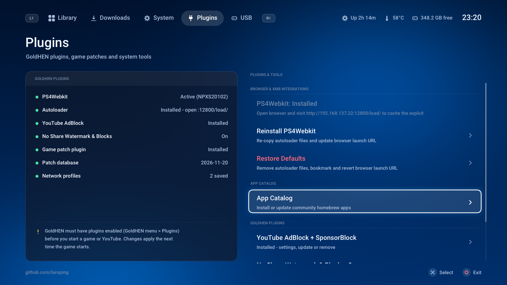

#  PS4Hub Suite

PS4Hub is an on-console utility for managing `app.db` home layouts, mounting NTFS storage via `libntfs-3g`, and installing packages via an embedded RPI server (port 12800). PS4 Package Sender is the Windows desktop companion for streaming `.pkg` files to PS4 and PS5 consoles over LAN.

> [!IMPORTANT]
> Verified on **PS4 Pro**, **Firmware 14.02** with GoldHEN.

> [!WARNING]
> **`Rebuild game database (Untested)`** is the only untested function in PS4Hub. It can corrupt `app.db` — use at your own risk (`app.db` is backed up before execution).

---

## Prebuilt Releases

Download binaries from [Releases](https://github.com/laroping/ps4hub/releases):

- [`ps4hub.pkg`](https://github.com/laroping/ps4hub/releases/download/v1.27/ps4hub.pkg) — PS4Hub v1.27 (`CPAN00001`).
- [`ps4-package-sender.exe`](https://github.com/laroping/ps4hub/releases/download/v1.27/ps4-package-sender.exe) — standalone Windows binary (Rust + Tauri 2 / WebView2).

---

## 1. PS4Hub



C++17 console application built with the OpenOrbis PS4 toolchain, Dear ImGui (CPU framebuffer rasterizer over SDL2), SQLite3, and `libntfs-3g`.

### Capabilities

#### Home Layout & `app.db`
- Reads tiles and folder containers from `/system_data/priv/mms/app.db` (`tbl_appbrowse*`).
- Pins titles to the front (`2099` timestamp / `ui_pos`), sends titles to the back (`2000` timestamp / `ui_pos >= 900`), assigns fixed slot indices (`1..N`), and supports interactive reordering.
- Saves, loads, and deletes layout profiles (`fixed_positions.txt` + `app.db` copies), restores the pre-PS4Hub baseline layout, and resets titles to native last-played timestamps.
- Hides or restores installed tiles, toggles `"What's New"` (`NPXS29998`) and `"PlayStation Store"` (`NPXS20001`), and removes orphaned rows for uninstalled titles.
- Creates an `app.db` backup prior to writes, restores backups, and triggers console reboot (`SceSystemService` / `SceSystemStateMgr`).
- Experimental: **`Rebuild game database (Untested)`** scans `/user/app` for entries missing from `app.db` and re-registers them via `SceAppInstUtil`.

#### Title Inspector & Add-ons
- Background worker inspects `PARAM.SFO` (`TITLE_ID`, `APP_VER`, `VERSION`, `SYSTEM_VER`, `PUBTOOLINFO` SDK version) and computes recursive sizes for Base (`/user/app`), Patch (`/user/patch`), and Add-on (`/user/addcont`) directories across internal and extended storage.
- Lists and uninstalls individual updates and DLC entitlements through `SceAppInstUtil`.

#### Remote Package Installer Server (Port `12800`)
- Multi-threaded HTTP server on TCP port `12800`, wire-compatible with flatZ Remote Package Installer (`POST /api/install` for `direct` and `ref_pkg_url`, `/api/get_task_progress`, `start_task`, `stop_task`, `pause_task`, `resume_task`, `unregister_task`, `find_task`, `is_exists`, `uninstall_game`, `uninstall_patch`, `uninstall_ac`, `uninstall_theme`) plus `/api/v2/install`, `/api/v2/system`, and `/static/<file>` manifests.
- Accepts RFC 1918 LAN and loopback clients only.
- On-console queue tracks active transfers, remaining time, and activity logs, with pause/resume/stop controls.

#### NTFS USB Storage & Package Installation
- Embedded `libntfs-3g` user-space driver on `/dev/da*s*` via `sceKernelOpen` (512-byte sector-aligned bounce I/O, read-only mount) to browse directories and install `.pkg` files through the local HTTP endpoint and `SceBgft`.
- Lists PS4 shell mounts (`/mnt/usb*`, `/mnt/ext*`, exFAT/FAT) read-only; package installation from exFAT shell mounts is blocked.

#### App Catalog
- Fetches version manifests (HTTP/HTTPS) and GitHub Releases metadata for YouTube, Netflix, PS4 Explorer, Apollo Saves, PSBox Cloud, Moonlight, ScummVM, and Harissa64, tracking installed versions across regional Title ID aliases and proxying HTTPS `.pkg` downloads through local BGFT tasks.

#### WebKit Browser Integration & Autoloader
- Bundles the offline exploit host from [ps4webkit](https://github.com/laroping/ps4webkit) (`5.05`, `7.00`, `9.00`, `CSS`, `SlopKit`, `goldhen_2.4b18.14.bin`) copied to `/user/data/ps4hub/autoloader` and served over `/load/`.
- `Install PS4Webkit` backs up `/user/data/ps4hub/backup_browser/`, updates `launch_url` for `NPXS20102` when present in `app.db` without altering browser title or icon, inserts `PS4Webkit Loader` (`/load/`) and `PS4Webkit Loader (Online)` (`https://laroping.github.io/ps4webkit/`) bookmarks into per-user `webbrowser_bookmark.db`, and exposes `Restore Defaults`.

#### GoldHEN Plugins & Game Patches
- Downloads `yt_adblock.prx` from GitHub releases (`[CUSA01015]` in `/data/GoldHEN/plugins.ini`) and writes 12 SponsorBlock categories + skip mode to `/data/youtube/config.json`.
- Downloads and toggles `no_share_watermark.prx` under `[default]`.
- Downloads `game_patch.prx` and the GoldHEN patch XML database; toggles per-patch settings files (`0x<djb2_hash>.txt`) matched by title ID and installed `APP_VER`.

#### System Tools
- **Update blocker:** toggles empty directories at `/update/PS4UPDATE.PUP` and `/update/PS4UPDATE.PUP.net.temp`.
- **Network profiles:** copies and restores wired LAN/PPPoE/DHCP registry keys under `/user/data/ps4hub/network/` (Wi-Fi unsupported).
- **Background services:** probes local ports for FTP, klog, and payload loaders; terminates non-protected `eboot.bin` processes.
- **Temporary cleaner:** removes PS4Hub and known scratch files without touching browser state, cache, or savedata.

---

## 2. PS4 Package Sender


Windows desktop client written in Rust and Tauri 2 (WebView2) with a plain HTML/CSS/JS frontend.

### Capabilities
- **Embedded HTTP Server:** `std::net` multi-threaded server with HTTP `Range` support, throughput metering, interface/port selection, `SO_EXCLUSIVEADDRUSE`, non-inheritable sockets (`WSA_FLAG_NO_HANDLE_INHERIT`), `RST` close on shutdown, and Windows TCP table port-owner detection (`GetExtendedTcpTable`).
- **Protocols:**
  - **PS4 RPI (flatZ) / PS4Hub** (`HTTP :12800`) — task creation, progress/speed/ETA polling, pause/resume/stop, `is_exists`, uninstall.
  - **PS5 etaHEN DPI v2** (`HTTP :12800`) and **DPI v1** (`TCP :9090`) — upload trigger with server-side transfer progress tracking.
- **Queue & Library:** base directory scanner (optional deep scan), drag-and-drop ingestion, PKG header/`PARAM.SFO`/`icon0.png` extraction (including localized `0x1220..0x123F` icon entries and Title ID icon fallback), sequential queue scanner, and `/24` subnet discovery.

---

## Project Structure

```text
ps4hub/
├── media/
│   ├── ps4hub.png
│   └── ps4-package-sender.png
├── ps4hub/
│   ├── assets/
│   ├── sce_module/
│   ├── sce_sys/
│   ├── src/
│   ├── third_party/
│   ├── tools/
│   ├── build.sh
│   ├── Makefile
│   └── project.gp4
├── ps4-package-sender/
│   ├── capabilities/
│   ├── gen/
│   ├── icons/
│   ├── src/
│   ├── tools/
│   ├── ui/
│   ├── Cargo.lock
│   ├── Cargo.toml
│   └── tauri.conf.json
├── .gitignore
└── README.md
```

---

## Building

### PS4Hub
Requires OpenOrbis PS4 Toolchain, LLVM `clang`/`lld`, GoldHEN SDK (expected under `ps4hub/.toolchain/`), and .NET runtime for `PkgTool.Core.exe`:

```bash
cd ps4hub
./build.sh
```

Output: `ps4hub/ps4hub.pkg`.

### PS4 Package Sender
Requires Rust (`cargo`), MSVC Build Tools / Windows SDK, and WebView2 Runtime:

```powershell
cd ps4-package-sender
cargo build --release
```

Output: `ps4-package-sender\target\release\ps4-package-sender.exe`.

Tests:

```powershell
cd ps4-package-sender
cargo test
```

---

## Credits

- **Author:** [laroping](https://github.com/laroping)
- **Bundled / Integrated Ecosystem:** OpenOrbis PS4 Toolchain, GoldHEN SDK, Dear ImGui, SQLite3, `libntfs-3g`, flatZ Remote Package Installer protocol.
