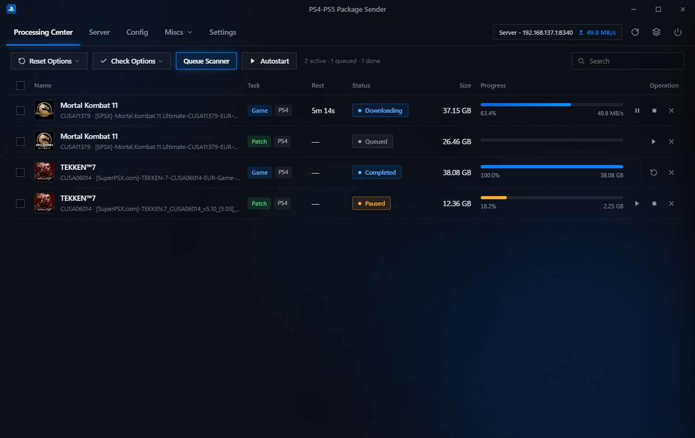

#  PS4Hub

PS4Hub is an on-console PS4 utility for managing `app.db` home layouts, browsing NTFS USB drives with a built-in NTFS file explorer to install `.pkg` files directly from NTFS storage, and receiving packages via an embedded RPI server (port 12800). PS4-PS5 Package Sender is the Windows desktop companion for streaming `.pkg` files to PS4 and PS5 consoles over LAN.

> [!IMPORTANT]
> Verified on **PS4 Pro**, **Firmware 14.02** with GoldHEN.

> [!WARNING]
> **`Rebuild game database (Untested)`** is the only untested function in PS4Hub. It can corrupt `app.db` - use at your own risk (`app.db` is backed up before execution).

---

## Prebuilt Releases

Download binaries from [Releases](https://github.com/laroping/ps4hub/releases):

- [`ps4hub.pkg`](https://github.com/laroping/ps4hub/releases/download/v1.27/ps4hub.pkg) - PS4Hub v1.27 (`CPAN00001`).
- [`ps4-ps5-package-sender.exe`](https://github.com/laroping/ps4hub/releases/download/v1.27/ps4-ps5-package-sender.exe) - standalone Windows binary (Rust + Tauri 2 / WebView2).

---

## 1. PS4Hub


C++17 PS4 homebrew application built with OpenOrbis, Dear ImGui, SQLite3, and `libntfs-3g`.

### Capabilities
- **Home Layout (`app.db`):** pin, reorder, hide or restore tiles (including `"What's New"` and `"PlayStation Store"`), save/load layout profiles, backup & restore `app.db`, and experimental `Rebuild game database (Untested)`.
- **Title & Add-on Manager:** inspects installed Base, Patch, and DLC sizes/versions and uninstalls individual updates or DLC.
- **Remote Package Installer (`:12800`):** LAN HTTP server compatible with flatZ RPI / PS4-PS5 Package Sender, with on-console transfer queue and pause/resume/stop controls.
- **NTFS USB Explorer & Direct `.pkg` Installer:** browse NTFS-formatted USB drives (HDD/SSD/flash) directly on PS4 and install `.pkg` files locally without converting to exFAT; PS4 shell exFAT mounts are read-only.
- **App Catalog:** downloads and installs curated homebrew packages directly on the console.
- **WebKit & Autoloader:** bundles the offline GoldHEN autoloader from [ps4webkit](https://github.com/laroping/ps4webkit) (`5.05-14.02`), adds local (`/load/`) and online (`https://laroping.github.io/ps4webkit/`) bookmarks, and supports `Restore Defaults`.
- **GoldHEN Plugins & Game Patches:** installs and toggles YouTube AdBlock (+ SponsorBlock), No Share Watermark, and GoldHEN XML game patches.
- **System Tools:** firmware update blocker, wired LAN profile backup/restore, local service monitor, and temporary file cleaner.

---

## 2. PS4-PS5 Package Sender



Windows desktop client written in Rust and Tauri 2 (WebView2).

### Capabilities
- **HTTP Streaming Server:** multi-threaded LAN server with `Range` support, throughput metering, interface/port selection, and port-conflict detection.
- **Console Protocols:** supports PS4 RPI (flatZ) / PS4Hub (`HTTP :12800`), PS5 etaHEN DPI v2 (`HTTP :12800`), and DPI v1 (`TCP :9090`).
- **Library & Queue:** base directory scanner, drag-and-drop PKG ingestion, automatic `PARAM.SFO`/icon extraction, sequential install queue, and LAN console discovery.

---

## Project Structure

```text
ps4hub/
├── media/
│   ├── ps4hub.png
│   └── ps4-ps5-package-sender.png
├── ps4hub/
│   ├── assets/
│   ├── sce_module/
│   ├── sce_sys/
│   ├── src/
│   ├── third_party/
│   ├── tools/
│   ├── build.sh
│   ├── Makefile
│   └── project.gp4
├── ps4-ps5-package-sender/
│   ├── capabilities/
│   ├── gen/
│   ├── icons/
│   ├── src/
│   ├── tools/
│   ├── ui/
│   ├── Cargo.lock
│   ├── Cargo.toml
│   └── tauri.conf.json
├── .gitignore
└── README.md
```

---

## Building

### PS4Hub
Requires OpenOrbis PS4 Toolchain, LLVM `clang`/`lld`, GoldHEN SDK (`ps4hub/.toolchain/`), and .NET runtime for `PkgTool.Core.exe`:

```bash
cd ps4hub
./build.sh
```

Output: `ps4hub/ps4hub.pkg`.

### PS4-PS5 Package Sender
Requires Rust (`cargo`), MSVC Build Tools / Windows SDK, and WebView2 Runtime:

```powershell
cd ps4-ps5-package-sender
cargo build --release
```

Output: `ps4-ps5-package-sender\target\release\ps4-ps5-package-sender.exe`.

Tests:

```powershell
cd ps4-ps5-package-sender
cargo test
```

---

## Credits

- **Author:** [laroping](https://github.com/laroping)
- **Bundled / Integrated Ecosystem:** OpenOrbis PS4 Toolchain, GoldHEN SDK, Dear ImGui, SQLite3, `libntfs-3g`, flatZ Remote Package Installer protocol.
